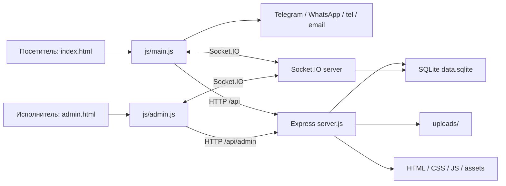

# Web Master Landing: handoff

> Актуальность: 2026-11-25
> Репозиторий: `https://github.com/imozzuhin88-star/web-master-landing.git`  
> Основная ветка: `main`  
> Базовый коммит перед текущим релизом: `cc6a466` (`Restore complete landing motion and scroll-driven background`)
> Назначение документа: дать новому разработчику или ИИ достаточно контекста, чтобы продолжить работу без повторного полного аудита проекта.

## Правило актуализации этого файла

`handoff.md` является частью проекта, а не одноразовым отчетом. Его необходимо обновлять в том же commit, в котором происходит любое значимое изменение:

- меняются архитектура, API, Socket.IO-события или схема базы данных;
- добавляются или удаляются страницы, компоненты, зависимости и переменные окружения;
- меняются команды запуска, сборки, публикации или требования к Node.js;
- реализуется пункт из TODO или обнаруживается новая существенная проблема;
- изменяются публичные контакты, тарифы, платежные реквизиты или логика обработки заявок;
- меняется статус продакшен-развертывания.

При обновлении нужно исправить дату и, если работа уже закоммичена, хеш состояния в шапке документа.

## 1. Цель и назначение проекта

`web-master-landing` — одностраничный коммерческий сайт русскоязычного веб-мастера для продажи услуг разработки сайтов малому бизнесу. Основные бизнес-задачи:

1. Объяснить ценность услуги и показать доступные форматы работы.
2. Показать процесс и ориентировочные цены.
3. Привести посетителя к обращению через Telegram, WhatsApp, телефон или email.
4. Принять структурированную заявку и сохранить ее на сервере, если серверная часть доступна.
5. Предоставить встроенный чат посетителя с исполнителем в реальном времени.
6. Дать исполнителю закрытую страницу для просмотра диалогов и ответа клиентам.
7. Показать платежные реквизиты и дать возможность скопировать их.

Проект поддерживает два существенно разных режима:

| Режим | Что работает | Что не работает |
|---|---|---|
| Статическая публикация, например GitHub Pages | Контент, адаптивная верстка, навигация, контакты, черновик заявки, переходы в мессенджеры | Серверное сохранение заявок, реальный чат, админка, загрузка файлов, SQLite и API |
| Полный Node.js-сервер | Весь статический интерфейс плюс API, SQLite, загрузки, Socket.IO-чат, присутствие администратора и админка | Требует постоянно работающего процесса Node.js и постоянного диска |

Критически важно не считать GitHub Pages полноценным продакшеном этого приложения: GitHub Pages обслуживает только файлы и не запускает `server.js`.

## 2. Текущее публичное содержимое

Контакты находятся в `contactConfig` в `js/main.js` и продублированы в HTML как резервные значения:

- телефон: `+7 921 656-67-16` (`tel:+79216566716`);
- Telegram: `@GG22870` (`https://t.me/GG22870`);
- WhatsApp: `+7 921 656-67-16` (`https://wa.me/79216566716`);
- email: `mozhzhukhin@gmail.com`.

Текущие цены находятся в `offerConfig` в `js/main.js` и продублированы в `index.html`:

- доработка: от `1 500 Р`;
- лендинг: от `7 900 Р`;
- сайт под ключ: от `15 900 Р`.

Платежные данные в `paymentConfig` пока являются заглушками:

- банк: `Ваш банк`;
- карта: `0000 0000 0000 0000`;
- получатель: `Иван Иванов`;
- назначение: `Разработка сайта`.

С 2026-11-11 карточка с реквизитами скрыта из публичного интерфейса и заменена нейтральным сообщением: реквизиты выдаются после согласования проекта. Не публиковать сайт как принимающий реальные платежи, пока заглушки не заменены подтвержденными реквизитами. Любые значения в клиентском JavaScript и HTML являются публичными и не должны содержать секреты.

В секции `#projects` есть проверенные публичные работы: Steam 2.0 (`https://imozzuhin88-star.github.io/stems-suyt/`) и «СтройДом» (`https://imozzuhin88-star.github.io/stroidom-construction-landing/`). Это внешние ссылки, открывающиеся в новой вкладке.

## 3. Технологический стек и версии

### Среда выполнения и инструменты

| Технология | Проверенная версия | Требование/назначение |
|---|---:|---|
| Node.js | `24.14.0` | Сервер и встроенный модуль `node:sqlite` |
| pnpm | `11.9.0` | Установка зависимостей и запуск scripts |
| lockfile pnpm | формат `9.0` | Воспроизводимая установка зависимостей |
| SQLite | встроен в Node.js | Локальное хранение заявок и сообщений |
| Git | репозиторий на GitHub | Контроль версий и текущая статическая публикация |

Рекомендуемая среда — актуальная Node.js 24 LTS и pnpm 11. Код использует `DatabaseSync` из `node:sqlite`, поэтому старые версии Node.js не подходят. Технический минимум для API появился в Node.js 22.5, но проект следует проверять и поддерживать на Node.js 24.

### Прямые серверные зависимости

Версии ниже взяты из `pnpm-lock.yaml`; диапазоны — из `package.json`.

| Библиотека | Диапазон | Установлено | Зачем используется |
|---|---:|---:|---|
| `express` | `^4.21.2` | `4.22.2` | HTTP-сервер, API, маршруты страниц и раздача статических файлов |
| `express-rate-limit` | `^7.5.0` | `7.5.1` | Ограничение частоты публичных и административных запросов |
| `helmet` | `^8.0.0` | `8.2.0` | Базовые защитные HTTP-заголовки |
| `multer` | `^2.0.2` | `2.2.0` | Прием файлов из чата и сохранение в `uploads/` |
| `socket.io` | `^4.8.1` | `4.8.3` | Двусторонний чат, typing-индикатор и статус присутствия |
| `zod` | `^3.24.1` | `3.25.76` | Валидация заявок, сообщений, UUID комнат и входных данных |

### Клиентские зависимости

| Библиотека/ресурс | Версия | Способ подключения | Назначение |
|---|---:|---|---|
| Socket.IO Client | `4.8.3` | локальный `js/socket.io.min.js` | Подключение браузера к Socket.IO-серверу |
| Lucide | `0.468.0` | CDN `unpkg.com` | Иконки интерфейса через `data-lucide` |
| Google Fonts Manrope | без фиксированной версии | `fonts.googleapis.com` | Основной текстовый шрифт |
| Google Fonts Unbounded | без фиксированной версии | `fonts.googleapis.com` | Акцентный шрифт заголовков и бренда |

Frontend написан без фреймворка, сборщика и TypeScript: обычные HTML5, CSS3 и современный browser JavaScript. Используются `crypto.randomUUID`, `fetch`, `FormData`, `IntersectionObserver`, `localStorage`, `sessionStorage`, Clipboard API и optional chaining.

## 4. Структура репозитория

```text
web-master-landing/
├── .agents/                 # Пустая локальная папка
├── .codex/                  # Локальные инструкции, память и навыки Codex
├── .idea/                   # Локальные настройки WebStorm; игнорируются Git
├── .pnpm-store/             # Локальный кэш pnpm; игнорируется Git
├── assets/
│   └── hero-services.png    # PNG 1717x916, ~1.63 МБ; используется в hero публичного лендинга
├── css/
│   ├── style.css            # Все стили публичного лендинга и chat widget
│   └── admin.css            # Стили входа и интерфейса администратора
├── js/
│   ├── main.js              # Публичный frontend: контакты, форма, чат, анимации, навигация
│   ├── admin.js             # Frontend административной страницы
│   ├── socket.io.min.js     # Локальная сборка Socket.IO Client 4.8.3
│   └── socket.io.min.js.map # Source map локальной клиентской библиотеки
├── node_modules/            # Установленные пакеты; игнорируются Git
├── .env.example             # Шаблон обязательных параметров запуска
├── .gitignore               # Исключения для зависимостей, БД, загрузок, IDE и секретов
├── admin.html               # Закрытая страница сообщений исполнителя
├── index.html               # Публичный одностраничный сайт
├── package.json             # Метаданные, scripts и диапазоны зависимостей
├── pnpm-lock.yaml           # Зафиксированное дерево зависимостей
├── server.js                # Express, API, SQLite, uploads и Socket.IO
└── handoff.md               # Этот документ
```

`.agents/` пустая. В `.codex/` находятся `memory.md` и два project-local навыка: `maintain-web-master-landing` и `release-web-master-landing`; корневой `AGENTS.md` дополняет этот handoff общими правилами работы. Они не переопределяют `handoff.md`. В репозитории по-прежнему нет README, тестов и CI-конфигурации.

В Git отслеживаются только исходники, lockfile и `assets/hero-services.png`. `.idea/`, `.pnpm-store/`, `node_modules/`, `.env`, `uploads/` и файлы SQLite локальные и не должны коммититься.

## 5. Установка зависимостей

### Требования

1. Установить Node.js 24 LTS.
2. Установить pnpm 11, например через Corepack.
3. Клонировать репозиторий и перейти в его корень.

Проверка среды:

```powershell
node --version
pnpm --version
```

Установка строго по lockfile:

```powershell
pnpm install --frozen-lockfile
```

Для обычной локальной разработки допустимо `pnpm install`, но изменение `pnpm-lock.yaml` следует коммитить только вместе с осознанным обновлением зависимостей.

## 6. Переменные окружения

В коде используются только две переменные:

| Переменная | Обязательность | Пример без секрета | Описание |
|---|---|---|---|
| `PORT` | необязательная | `3000` | TCP-порт HTTP/Socket.IO-сервера. По умолчанию `3000` |
| `ADMIN_TOKEN` | обязательная | `<длинная случайная строка>` | Общий секрет для входа в админку, чтения списка комнат и административного Socket.IO-подключения |

Шаблон находится в `.env.example`. Реальный `.env` намеренно игнорируется Git. Не помещать реальный `ADMIN_TOKEN` в код, документацию, issue, commit или frontend.

Важно: проект не зависит от `dotenv`, а scripts `pnpm start` и `pnpm dev` не передают `--env-file`. Поэтому наличие `.env` само по себе не загружает переменные.

Вариант запуска с `.env` средствами Node.js:

```powershell
Copy-Item .env.example .env
# Заменить шаблон ADMIN_TOKEN в .env на длинное случайное значение.
node --env-file=.env server.js
```

Вариант через переменные текущего PowerShell-процесса:

```powershell
$env:PORT = "3000"
$env:ADMIN_TOKEN = "<секрет из менеджера секретов>"
pnpm start
```

Для production переменные должен передавать хостинг или менеджер процессов, а не файл из репозитория. `NODE_ENV`, `HOST`, URL базы данных и внешнее хранилище текущим кодом не читаются.

## 7. Локальный запуск

### Обычный режим

После передачи переменных окружения:

```powershell
pnpm start
```

Открыть:

- публичный сайт: `http://localhost:3000/`;
- админку: `http://localhost:3000/admin.html`;
- health check: `http://localhost:3000/api/health`.

### Режим разработки с перезапуском

```powershell
$env:ADMIN_TOKEN = "<локальный секрет>"
pnpm dev
```

Или с `.env`:

```powershell
node --env-file=.env --watch server.js
```

При первом запуске сервер автоматически создает:

- `uploads/` для вложений;
- `data.sqlite` для данных;
- `data.sqlite-wal` и `data.sqlite-shm` при работе SQLite в WAL-режиме.

Эти файлы игнорируются Git. Не удалять рабочую БД или `uploads/` без резервной копии.

### Статический предпросмотр

Можно открыть `index.html` или запустить простой статический сервер, но это проверит только визуальную часть. API и real-time чат в таком режиме ожидаемо не работают.

## 8. Сборка и production

### Текущее состояние сборки

В проекте нет build script и нет этапа компиляции. Исходные `index.html`, `admin.html`, `css/`, `js/` и `assets/` одновременно являются публикуемыми статическими файлами.

Команда `pnpm build` отсутствует. Это не ошибка установки, а текущее устройство проекта.

### Полноценный production с backend

Рекомендуемый минимальный процесс:

```powershell
pnpm install --prod --frozen-lockfile
$env:PORT = "3000"
$env:ADMIN_TOKEN = "<секрет из настроек хостинга>"
node server.js
```

Production-платформа должна предоставлять:

- Node.js 24;
- HTTPS и reverse proxy;
- постоянный диск для `data.sqlite*` и `uploads/`;
- передачу `ADMIN_TOKEN` как секрета;
- перезапуск процесса после сбоя;
- резервные копии SQLite и uploads;
- поддержку долгих WebSocket-соединений.

Нельзя использовать эфемерный файловый диск без внешней БД/хранилища: после redeploy будут потеряны сообщения, заявки и вложения.

### GitHub Pages

Текущая ветка `main` синхронизирована с `origin/main`. GitHub Pages подходит только для статической демонстрации. После изменения файлов нужно:

1. сохранить изменения;
2. добавить их в Git;
3. создать commit;
4. отправить `main` на GitHub;
5. дождаться публикации Pages и обновить страницу с очисткой кэша.

Query-параметры `css/style.css?v=16` и `js/main.js?v=18` используются как ручной cache busting. При существенном изменении этих файлов версии нужно увеличивать или перейти на автоматическое хеширование assets.

2026-11-21: новый дизайн подготовлен к публикации в `main` по запросу владельца. Режим публикации — статический GitHub Pages; backend не разворачивается. Перед отправкой проверены синтаксис трех JavaScript-файлов и отсутствие ошибок `git diff --check`.

2026-11-21: релиз тёмного оформления, кейса Steam 2.0 и черновика заявки. На GitHub Pages и при открытии файла кнопка чата показывает прямые ссылки на Telegram и WhatsApp. В полном режиме сохраняется работа через Node.js.


2026-11-22: по запросу владельца одобренные в отдельном предпросмотре эффекты перенесены в исходники для коммита, push в `main` и публикации на существующем GitHub Pages. Новые `js/portfolio-motion.js` и `css/portfolio-motion.css` подключены из `index.html`: вход по квадратным плиткам, последовательная сборка миниатюры сайта, наклон и блик карточек Steam/«СтройДом», линия этапов и переключение снимков компьютер/телефон внутри Steam-превью. Пиксельный след и кнопки повтора исключены. Декоративные слои не перехватывают клики. Настройка «Анимация» по умолчанию учитывает системное уменьшение движения, явный выбор сохраняется в `web-master-motion`. Миниатюра запускается после завершения входного эффекта, чтобы плитки не закрывали её сборку. Ресурсы: основной CSS v17, main.js v19, portfolio-motion CSS/JS v1. Контакты, цены, платёжный текст, backend и режимы хостинга не изменены. Проверены установка по lockfile, синтаксис всех JS, браузерные сценарии на desktop и ширине 390 px, отсутствие горизонтального переполнения, сохранение настройки, исчезновение временных кнопок и следа. Фактическую публикацию следует подтверждать по содержимому новых ресурсов после push.


2026-11-22, исправление после публикации: ранний `js/startup.js?v=1` отключает автоматическое восстановление прежней прокрутки. Обычный URL и `#top` открывают первый экран при загрузке и `pageshow`; явные ссылки на разделы сохраняют своё назначение. `portfolio-motion.js?v=2` включает входную анимацию при первом посещении, сохраняя явный выбор «выкл». При системном уменьшении движения плитки и миниатюра используют мягкие изменения прозрачности вместо пространственных поворотов. Проверено в новом origin без сохранённых настроек при активном reduced motion: оба эффекта завершились, перезагрузка после прокрутки в портфолио вернула первый экран. Коммит предыдущего выпуска: `97e2497`.


2026-11-22, восстановление полного набора эффектов: выяснено, что старые CSS-правила reduced motion и ветвление новых входных эффектов независимо подавляли ранее одобренное движение. Теперь явная настройка сайта «Анимация» (`data-motion`, сохранение `web-master-motion`) единообразно управляет входом по пространственным плиткам, сборкой миниатюры, появлениями, линией этапов и фоном. В режиме «вкл» используется полный одобренный эффект; в режиме «выкл» контент сразу доступен без движения. Перелив `larper` рассчитывается по прокрутке через CSS-переменные в JavaScript, работает без `animation-timeline`; звёздочки в полосе преимуществ поворачиваются при прокрутке. Проверены не только конечные состояния, но и наличие matrix3d на плитках при запуске, изменение матрицы фона при прокрутке, длительность появления 850 мс при системном reduced motion и отключение эффектов без скрытого контента. Новые версии portfolio-motion CSS/JS v3; startup JS v1 сохраняет открытие обычного URL сверху.


2026-11-25: владелец одобрил коммит, push и публикацию фиолетового кругового вступления из отдельного предпросмотра. Новые `js/circle-intro.js` и `css/circle-intro.css` заменяют прежний вход по квадратным плиткам: тонкие лавандовые кольца на сливовом фоне расходятся, соединяются и раскрывают лендинг круглой маской. После вступления запускается существующая миниатюра. Добавлены пропуск и Escape, fallback без CSS-масок, ограничение ожидания ресурсов и пауза при скрытии вкладки; затем восстанавливаются прокрутка и клавиатурная доступность. Вступление скрыто в исходной разметке, чтобы отказ JavaScript не закрывал страницу. Сигнал `landing-entry-complete` и флаг `data-entry-complete` корректно обрабатывают ранний пропуск до инициализации миниатюры. Перед отправкой владелец отдельно попросил убрать переключатель «Анимация»: UI удалён, `web-master-motion` больше не читается и не записывается, старое сохранённое «выкл» не отключает эффекты. Перелив фона, звёздочки, наклон карточек, этапы и переключение снимков сохранены. Новый архив проектов из другого макета в этот релиз не входит. Версии circle-intro CSS/JS v1, portfolio-motion CSS/JS v4; startup JS v1 по-прежнему открывает обычный адрес сверху. Проверены установка по lockfile, синтаксис JS, полный переход, пропуск, восстановление доступности, мобильная ширина 390 px и работа эффектов после удаления переключателя. Backend и публичные контакты/цены не изменялись.

## 9. Архитектура приложения



### Публичный frontend

`index.html` содержит всю семантическую разметку лендинга и виджета чата. `css/style.css` отвечает за desktop/mobile layout, состояния, анимации и визуальный стиль. `js/main.js`:

- подставляет контакты, цены и платежные данные из конфигурации;
- готовит текст заявки и открывает выбранный мессенджер;
- пытается параллельно сохранить заявку через API;
- управляет копированием платежных данных;
- создает и хранит UUID комнаты посетителя;
- загружает историю сообщений или использует локальный кэш;
- подключается к Socket.IO и управляет чатом;
- отвечает за меню, active navigation, scroll-to-top, reveal и tilt-эффекты.

### Backend

`server.js` — единый CommonJS-модуль без разделения на слои. Он при загрузке:

1. проверяет обязательный `ADMIN_TOKEN`;
2. создает `uploads/`;
3. открывает SQLite и создает таблицы при отсутствии;
4. настраивает Express middleware и статические маршруты;
5. регистрирует REST API;
6. запускает Socket.IO поверх того же HTTP-сервера;
7. начинает слушать `PORT`.

### Административный frontend

`admin.html` показывает форму входа, затем двухколоночный inbox. `js/admin.js` хранит токен в `sessionStorage`, получает список комнат, загружает выбранную историю, присоединяет администратора к Socket.IO-комнате и отправляет ответы с автором `seller`.

### Хранение состояния

| Данные | Где хранятся | Жизненный цикл |
|---|---|---|
| UUID комнаты посетителя | `localStorage: web-master-chat-session` | сохраняется между посещениями этого браузера |
| Локальный кэш чата | `localStorage: web-master-chat-cache` | последние 80 сообщений; fallback при недоступном API |
| Admin token | `sessionStorage: web-master-admin-token` | до закрытия вкладки/сессии браузера |
| Сообщения | SQLite `messages` | постоянно, пока сохранен диск |
| Заявки | SQLite `leads` | постоянно, но UI просмотра заявок пока отсутствует |
| Вложения | локальная папка `uploads/` | постоянно, пока сохранен диск; публично доступны по URL |
| Онлайн-статус | счетчик `adminCount` в памяти Node.js | сбрасывается при перезапуске процесса |

## 10. Модель данных

Схема создается inline в `server.js`; отдельной системы миграций нет.

### Таблица `messages`

| Поле | Тип | Назначение |
|---|---|---|
| `id` | `TEXT PRIMARY KEY` | UUID сообщения; повторная вставка игнорируется |
| `room` | `TEXT NOT NULL` | UUID диалога посетителя |
| `author` | `TEXT NOT NULL` | `visitor` или `seller` |
| `text` | `TEXT` | текст до 1000 символов |
| `fileUrl` | `TEXT` | URL загруженного файла |
| `fileName` | `TEXT` | исходное имя файла |
| `fileType` | `TEXT` | MIME type |
| `createdAt` | `TEXT NOT NULL` | ISO datetime, формируется клиентом |

### Таблица `leads`

| Поле | Тип | Назначение |
|---|---|---|
| `id` | `INTEGER PRIMARY KEY AUTOINCREMENT` | внутренний идентификатор |
| `name` | `TEXT NOT NULL` | имя, 2-80 символов |
| `phone` | `TEXT NOT NULL` | телефон, 5-32 символа |
| `service` | `TEXT` | выбранная услуга, до 80 символов |
| `budget` | `TEXT` | выбранный бюджет, до 80 символов |
| `message` | `TEXT` | описание задачи, до 1500 символов |
| `createdAt` | `TEXT NOT NULL` | ISO datetime сервера |

SQLite включен в режиме WAL. Индексы для `room` и `createdAt` отсутствуют.

## 11. HTTP API

| Метод и путь | Доступ | Назначение и ответ |
|---|---|---|
| `GET /api/health` | публичный | `{ ok: true }`; базовая проверка процесса |
| `GET /api/messages?room=<uuid>` | публичный, rate limit | До 100 сообщений комнаты по возрастанию времени |
| `POST /api/leads` | публичный, rate limit | Валидирует и сохраняет заявку; `201 { ok: true }` |
| `POST /api/uploads` | публичный, rate limit | Один файл до 5 МБ плюс UUID комнаты; возвращает метаданные файла |
| `POST /api/admin/login` | admin rate limit | Проверяет JSON `{ token }`; не выдает отдельную сессию/JWT |
| `GET /api/admin/rooms` | Bearer token, admin rate limit | Возвращает до 100 комнат с последней активностью и preview |

Общий limit: 100 запросов за 15 минут на IP. Admin limit: 10 запросов за 15 минут на IP.

Разрешенные MIME types вложений:

- JPEG, PNG, WebP, GIF;
- PDF;
- plain text;
- DOC;
- DOCX.

Статические URL:

- `/uploads/*` — кэш 7 дней, directory index выключен;
- `/assets/*` — кэш 7 дней;
- `/css/*` и `/js/*` — кэш 1 день;
- `/` и `/index.html` — публичная страница;
- `/admin.html` — административная страница.

## 12. Socket.IO-протокол

| Событие | Направление | Payload | Назначение |
|---|---|---|---|
| `join` | клиент → сервер | `{ room }` | Посетитель присоединяется к UUID-комнате |
| `admin-join` | админ → сервер | `{ token, room? }` | Проверка token, регистрация администратора и вход в комнату |
| `presence` | сервер → клиенты | `{ online }` | Есть ли хотя бы один admin socket во всем процессе |
| `typing` | в обе стороны через сервер | `{ room, active }` | Индикатор набора сообщения другим участником |
| `message` | в обе стороны через сервер | message object | Валидация, запись в SQLite и broadcast в комнату |
| `error-message` | сервер → отправитель | `{ error }` | Ошибка доступа или валидации сообщения |

Сообщение должно иметь UUID `id`, UUID `room`, `author`, ISO `createdAt` и хотя бы `text` или `fileUrl`. Сервер запрещает отправлять `author: seller` сокету без admin-доступа.

## 13. Страницы и ключевые компоненты

### `index.html`

1. `page-loader` — полноэкранная заставка, скрывается после события `load`.
2. Sticky header — бренд, desktop/mobile menu, ссылки на секции, кнопка чата и переключатель темы.
3. Hero — заголовок «Сайты и лендинги», приветствие от Ивана, CTA и список работ поверх статичной canvas-сетки крестиков, без фотографии.
4. Trust strip — этапы «стратегия / дизайн / разработка / запуск».
5. `#services` — карточки «Лендинг», «Сайт-визитка», «Доработки», «Заявки и запуск».
6. `#projects` — две карточки портфолио. Кнопка «Разобрать проект» в карточке Steam 2.0 открывает `#steam-case` со снимками для компьютера и телефона. Из разбора можно открыть бриф с проектом Steam 2.0 и услугой «Сайт под ключ».
7. `#process` — три этапа работы.
8. `#prices` — три тарифных формата с ценами из `offerConfig`.
9. `#request` — бриф с предвыбором услуги из тарифа, полем ссылки для доработки и предпросмотром текста. Черновик можно скопировать или открыть в Telegram/WhatsApp. В полном режиме заявка сохраняется при первой попытке открыть мессенджер.
10. `#contacts` — телефон, Telegram, WhatsApp, email, встроенный чат и примечание о реквизитах после согласования.
11. `signal-field` и `site-readout` — визуальный canvas-фон и фиксированная строка состояния; они не связаны с backend-проверкой доступности.
10. Footer — бренд, динамический год и кнопка чата.
11. Back-to-top и toast region.
12. `#chatWidget` — dialog с presence, поиском, историей, typing, quick replies, upload и отправкой.
13. `#chatFab` — плавающая кнопка и счетчик непрочитанных сообщений.

### `admin.html`

1. `#loginPanel` — ввод общего `ADMIN_TOKEN`.
2. `#inbox` — скрыт до успешного входа.
3. `.room-list` — комнаты и ручное обновление.
4. `.admin-chat` — заголовок активного диалога, сообщения и форма ответа.
5. Страница закрыта от индексации через `noindex,nofollow`, но сам URL публичен; безопасность обеспечивается только token-проверками API/Socket.IO.

## 14. Ключевые функции

### `js/main.js`

| Функция | Ответственность |
|---|---|
| `initializeContacts` | Переносит контакты, цены и реквизиты из config в DOM и ссылки |
| `buildLeadMessage` | Формирует готовый текст заявки для мессенджера |
| `sendLead` | Fire-and-forget POST заявки на `/api/leads` |
| `setupLeadForm` | Валидация формы, выбор канала и открытие мессенджера |
| `copyText`, `setupCopyButtons` | Clipboard API и статусы копирования реквизитов |
| `messageMarkup` | Безопасно создает DOM сообщения/вложения без вставки текста через HTML |
| `renderMessages`, `addMessage` | Фильтрация, рендер, local cache и unread badge |
| `loadMessages` | API history с fallback на `localStorage` |
| `connectChat` | Socket.IO lifecycle и события присутствия/typing/message |
| `openChat`, `closeChat`, `setupChat` | Полный UX chat widget, upload и восстановление focus |
| `setupMotion` | IntersectionObserver reveal и pointer tilt |
| `setupNavigation` | Sticky header state, active section, mobile menu, Escape, back-to-top |
| `setupTheme` | Переключает темы `larper`, `terminal`, `paper` и сохраняет выбор в `localStorage` |
| `setupSignalField` | Рисует декоративные цветные пиксели на canvas; при reduced motion оставляет статичный кадр |

### `js/admin.js`

| Функция | Ответственность |
|---|---|
| `time` | Форматирует время в `ru-RU` |
| `renderMessages` | Рисует сообщения активной комнаты |
| `selectRoom` | Загружает историю, выделяет комнату и делает admin join |
| `loadRooms` | Запрашивает список диалогов с Bearer token |
| `connect` | Создает admin Socket.IO-подключение |
| `startInbox` | Переключает login на inbox и начинает загрузку |

### `server.js`

| Функция | Ответственность |
|---|---|
| `saveMessage` | Идемпотентная вставка сообщения в SQLite |
| `hasAdminAccess` | Constant-time сравнение token через `timingSafeEqual` |
| `broadcastPresence` | Глобальный broadcast доступности администратора |

Остальная серверная логика сейчас находится прямо в route/socket callbacks.

## 15. CSS и визуальная система

### Уточнение первого экрана (2026-11-11)

- Hero пересобран: «Сайты и лендинги», приветствие от Ивана и прямые ссылки на две работы. Убраны фразы про ценность и обращения; заголовок услуг — «Здесь можно выбрать».
- Фото больше не используется в hero. Canvas рисует статичную регулярную сетку крестиков на черном фоне вместо случайных частиц; непрерывного redraw нет.
- Основной текст увеличен до 15–18 px. Чат, FAB, toast и back-to-top снова имеют `position: fixed`, шапка — `sticky`; не включать их в общие relative-селекторы.
- Проверен Chromium на 1440 и 390 px: окно чата находится внутри viewport, горизонтального overflow нет. Cache busting: CSS v9, JS v11.

`css/style.css` содержит базовую тему, layout всех секций, chat widget, анимации и responsive breakpoints `900px`, `640px`, `360px`. Публичная страница использует pixel-console визуальную систему: почти черный фон, magenta/cyan/green сигналы, canvas-пиксели, hard-edge панели и нижнюю status bar. Переключатель задает варианты `larper`, `terminal`, `paper`; визуальный слой вдохновлен публично доступным сайтом larperCord, но не использует его брендовые assets или исходный код. Также учитывается `prefers-reduced-motion` и есть `:focus-visible` outline.

Тема `larper` использует общий фон из трёх мягких градиентов по всему лендингу. В браузерах с поддержкой `animation-timeline` фон переливается при прокрутке. Блоки один раз плавно поднимаются при появлении, карточки подсвечиваются при наведении, кейс раскрывается плавно там, где браузер поддерживает `::details-content`. Область снимка в кейсе сохраняет высоту при переключении, а ссылка открывает выбранный снимок крупнее. При `prefers-reduced-motion` фон неподвижен, контент доступен сразу. Manrope используется для заголовков и длинного текста. Моноширинный шрифт остаётся на технических подписях и отдельных элементах интерфейса. При наведении плавно меняются тень и превью внутри карточки, при этом сама кнопка или карточка остаётся на месте. Нажатие и клавиатурный фокус выделены отдельно. Версии ресурсов для этой правки: CSS v16, JS v18.

Основные design tokens:

- темные поверхности `--night`, `--night-soft`;
- основной текст `--ink`, вторичный `--ink-soft`;
- акценты `--blue`, `--cyan`, `--mint`, `--violet`;
- общий радиус `--radius: 8px`;
- ограничение контента `1180px`.

В конце `style.css` расположены два крупных слоя переопределений: `Refined commercial layout` и следующие за ним студийный/`Signal interface` слои. Это работает за счет cascade, но усложняет поддержку и оставляет неиспользуемые правила.

`css/admin.css` минифицирован вручную почти в одну строку и содержит отдельную светлую тему inbox. Breakpoint мобильной админки — `640px`.

## 16. Текущее состояние

### Реализовано

- адаптивный русскоязычный лендинг;
- семантические секции, мобильное меню и клавиша Escape;
- услуги, процесс, тарифы, CTA и контактный блок;
- реальные телефон, Telegram и email владельца;
- WhatsApp-ссылка на тот же телефон;
- генерация сообщения заявки для Telegram/WhatsApp;
- сохранение заявки в SQLite при доступном backend;
- copy-to-clipboard для карты и реквизитов;
- real-time chat visitor ↔ seller;
- локальная история/fallback чата;
- поиск в сообщениях и quick replies;
- upload разрешенных файлов до 5 МБ;
- административный вход, список комнат и ответы;
- SQLite schema initialization и WAL;
- Zod validation, Helmet и rate limiting;
- локальный Socket.IO Client вместо CDN;
- статическая публикация через GitHub Pages;
- cache busting query strings для основных frontend assets.
- портфолио с двумя внешними работами и ссылками в hero;
- переключатель трех визуальных тем с сохранением выбора в браузере;
- пиксельный canvas-фон и нижняя status bar, безопасные для reduced motion;
- публичный интерфейс не показывает платёжные заглушки.

### Частично реализовано / требует доведения

- GitHub Pages показывает сайт, но backend-функции там недоступны;
- заявки записываются в таблицу `leads`, но их невозможно посмотреть через UI/API;
- платежный блок готов визуально, но содержит заглушки;
- admin typing отправляется, но UI администратора не показывает typing посетителя;
- chat fallback выглядит рабочим на static hosting, но сообщения остаются только в браузере;
- базовая accessibility предусмотрена, но полноценный аудит focus trap/screen reader не проводился;
- SEO metadata есть частично, но нет canonical URL, favicon и `og:image`.

### Не реализовано

- полноценный Node.js production deployment;
- автоматический CI/CD;
- unit/integration/e2e тесты;
- linting, formatting и type checking;
- миграции и индексы SQLite;
- просмотр и обработка лидов;
- logout и управление административной сессией;
- мониторинг, error tracking, structured logs и аналитика;
- backup/restore procedure;
- удаление/очистка старых uploads и orphan-файлов;
- privacy policy/consent для формы и хранения контактов;
- отдельные environments и конфигурация base URL.

## 17. Известные проблемы, ограничения и технический долг

### Критические и высокие

1. **Админка ломается при выборе комнаты.** В `js/admin.js` вызывается `$$`, но helper `$$` в этом файле не объявлен. Возникает `ReferenceError`, когда выполняется `selectRoom`.
2. **Backend не работает на GitHub Pages.** Чат, admin, upload и API требуют Node.js; статический хостинг не может выполнить `server.js`.
3. **Admin rate limit слишком низкий для текущего поведения.** `/api/admin/rooms` разрешает только 10 запросов за 15 минут, а `loadRooms()` вызывается после каждого нового сообщения. Активная переписка быстро блокирует inbox.
4. **История после 100 сообщений неверна.** Query использует `ORDER BY createdAt ASC LIMIT 100`, поэтому возвращает самые старые, а не последние сообщения.
5. **Нет авторизации чтения истории.** Любой, кто знает UUID комнаты, может вызвать `/api/messages` и читать переписку.
6. **Visitor socket не привязан к комнате.** Сервер проверяет UUID, но не проверяет, что отправитель сообщения или typing-события действительно joined в эту комнату.
7. **Файлы публичны и доверяют MIME клиента.** Нет проверки magic bytes, антивируса, авторизации скачивания или lifecycle cleanup.

### Средние

8. `MAX(text)` в `/api/admin/rooms` не гарантирует текст последнего сообщения; это лексикографический максимум, не значение строки с `MAX(createdAt)`.
9. Форма заявки игнорирует HTTP status `sendLead`: fetch без исключения считается успехом даже при `400/429/500`; пользователь об этом не узнает.
10. На static hosting запросы начинаются с `/api`, то есть уходят в корень домена GitHub Pages, а Socket.IO пытается подключиться к `github.io`. Ошибки скрываются fallback-логикой.
11. Токен после auto-login из `sessionStorage` не проверяется до скрытия login panel. При устаревшем token интерфейс может остаться в неудобном состоянии.
12. Админка не имеет logout, обработки `error-message`, reconnect state, retry UX и надежной обработки ошибок `loadRooms`.
13. Заявки накапливаются в БД, но нет административного endpoint/UI для чтения, статусов и экспорта.
14. Нет индексов `messages(room, createdAt)` и `leads(createdAt)`; рост данных ухудшит запросы.
15. Времена сообщений доверяются клиентскому `createdAt`, поэтому могут быть подделаны или некорректны.
16. Глобальный `adminCount` показывает «онлайн» всем посетителям, даже если администратор не открыл конкретную комнату; состояние не поддерживает несколько Node-инстансов.
17. Rate limiter хранит счетчики в памяти и не настроен для нескольких инстансов/reverse proxy (`trust proxy` отсутствует).
18. CSP отключена полностью (`contentSecurityPolicy: false`) ради внешних ресурсов вместо точной политики.

### Низкие и поддерживаемость

19. Контакты, цены и реквизиты продублированы в HTML и `js/main.js`; их легко рассинхронизировать.
20. `assets/hero-services.png` весит около 1.63 МБ и больше не используется в hero.
21. `style.css` содержит раннюю тему плюс три больших блока переопределений и неиспользуемые классы (`hero-glow`, `request-light`, `tag-status`, `card-arrow`).
22. `admin.css`, `admin.js` и большая часть `server.js` сжаты в длинные строки, что ухудшает review, debug и line-level history.
23. Нет `engines` и `packageManager` в `package.json`, хотя проект зависит от новой Node API.
24. `.env` не загружается scripts автоматически; это легко приводит к ошибке `Set ADMIN_TOKEN before starting the server.`
25. Нет build, lint, test, format, audit и CI scripts.
26. Cache busting выполняется вручную через `?v=N`.
27. Google Fonts и Lucide остаются внешними runtime-зависимостями; при блокировке CDN ухудшаются шрифты/иконки.
28. Не настроены favicon, canonical URL, sitemap, robots.txt и Open Graph image.
29. Telegram URL с `?text=` необходимо проверить на целевых клиентах: поддержка предварительного текста для прямой ссылки на пользователя может отличаться.
30. В `.gitignore` остаются похожие на старые/ошибочные имена `index.js` и `index.CCS.css`; причины не документированы.

## 18. Ближайшие задачи (TODO)

### P0 — восстановить корректную основную функциональность

1. Объявить `$$` в `js/admin.js`, добавить обработку ошибок и проверить полный сценарий admin login → room → reply.
2. Выбрать и настроить Node.js-хостинг с WebSocket и persistent volume; GitHub Pages оставить preview или перенаправить на production URL.
3. Заменить платежные заглушки на подтвержденные данные либо скрыть платежный блок до готовности.
4. Исправить выбор последних 100 сообщений и preview последнего сообщения.
5. Пересмотреть admin rate limit и убрать запрос списка комнат после каждого socket message либо сделать debounce/incremental update.

### P1 — безопасность и надежность

6. Авторизовать доступ к комнатам: выдать посетителю room token/session и проверять membership для history, typing, message и upload.
7. Усилить upload: проверять содержимое файла, генерировать безопасные имена, ограничить выдачу и удалять orphan/старые файлы.
8. Добавить admin session endpoint или короткоживущий signed token вместо постоянной передачи общего секрета.
9. Настроить точную CSP, `trust proxy`, production rate-limit store и допустимые origins.
10. Добавить миграции, индексы, backup/restore и проверку целостности SQLite.
11. Перенести `createdAt` сообщений на серверное время.

### P2 — продуктовая полнота

12. Добавить API и admin UI для списка лидов, статусов, заметок и экспорта.
13. Добавить logout, reconnect/error states, typing indicator и кликабельные вложения в admin UI.
14. Сделать честный static-mode UX: явно скрывать/отключать real-time функции при отсутствии backend.
15. Проверить Telegram/WhatsApp deep links на desktop, Android и iOS.
16. Добавить privacy notice и согласие на обработку контактных данных.
17. Добавить SEO assets: favicon, canonical, `og:image`, sitemap и robots.txt.

### P3 — качество разработки

18. Добавить `engines`, `packageManager`, scripts `check`, `test`, `lint`, `format` и при необходимости `build`.
19. Настроить unit tests для схем/утилит, API integration tests и Playwright e2e для desktop/mobile.
20. Разделить `server.js` на config, db, routes, sockets и middleware; форматировать JS/CSS.
21. Сделать единый источник публичной конфигурации без дублирования в HTML/JS.
22. Оптимизировать `hero-services.png` в современный сжатый формат и очистить неиспользуемый CSS.
23. Добавить GitHub Actions для проверок и управляемого deployment.
24. Добавить structured logging, health/readiness checks, monitoring и error tracking.

## 19. Рекомендации по дальнейшей архитектуре

1. Сначала определиться с целевым режимом: статический лидогенератор или полноценное приложение с чатом. Сейчас код пытается быть обоими, и fallback скрывает отсутствие backend.
2. Для полноценного варианта сохранить простой frontend, но разделить backend по зонам ответственности:

```text
src/
├── config.js
├── db/
│   ├── connection.js
│   └── migrations/
├── routes/
│   ├── health.js
│   ├── leads.js
│   ├── messages.js
│   ├── uploads.js
│   └── admin.js
├── sockets/
│   └── chat.js
├── middleware/
│   ├── auth.js
│   ├── rate-limit.js
│   └── errors.js
└── server.js
```

3. Не вводить frontend-фреймворк без реальной необходимости: текущий UI достаточно мал для модульного vanilla JS. Сначала исправить безопасность, deployment и тесты.
4. Если проект должен масштабироваться на несколько server instances, вынести данные из локальной SQLite/uploads: PostgreSQL для данных, S3-compatible storage для файлов, Redis adapter/store для Socket.IO и rate limiting.
5. Хранить публичную бизнес-конфигурацию отдельно от секретов. Например, server-rendered JSON/config endpoint или один versioned JS module; `ADMIN_TOKEN` остается только на сервере.
6. Добавить schema version и миграции до любых существенных изменений БД.
7. Для сообщений использовать cursor pagination по `(createdAt, id)`, а не фиксированный oldest-first limit.
8. Для admin auth использовать HTTPS, password hashing или внешний auth provider, server-side session/short-lived token и logout.

## 20. Проверки перед каждым релизом

Минимальный checklist:

- `pnpm install --frozen-lockfile` завершается успешно;
- `node --check server.js`, `node --check js/main.js`, `node --check js/admin.js` проходят;
- сервер стартует с тестовым `ADMIN_TOKEN`;
- `/api/health` возвращает `200`;
- заявка валидируется, открывает выбранный мессенджер и сохраняется при backend mode;
- visitor chat создает комнату, отправляет текст и файл;
- admin login, room selection и reply работают;
- reconnect не дублирует сообщения;
- контакты и цены совпадают в config и fallback HTML;
- реальные платежные данные проверены владельцем;
- desktop, tablet и mobile layouts проверены визуально;
- keyboard navigation, focus, Escape и reduced motion проверены;
- в Git не попали `.env`, SQLite, uploads, logs, `node_modules` и IDE state;
- `handoff.md` обновлен вместе с изменением;
- после push проверена фактически опубликованная версия, а не только локальный WebStorm preview.

## 21. Что уже проверено при подготовке handoff

- прочитаны все отслеживаемые текстовые исходники и конфигурации;
- проверена структура скрытых/локальных папок;
- при первоначальной подготовке handoff было подтверждено отсутствие `.env` и содержимого `.agents`; затем добавлены project-local файлы `.codex/` и `AGENTS.md`;
- подтверждены branch `main`, remote `origin` и синхронизация с `origin/main`;
- сверены package ranges и точные версии из lockfile/установленного дерева;
- проверены размеры и наличие ключевых assets;
- `server.js`, `js/main.js` и `js/admin.js` проходят синтаксическую проверку Node.js;
- scripts `start` и `dev` существуют; build/test/lint scripts отсутствуют;
- полноценный runtime smoke test не запускался, чтобы не создавать и не изменять локальные `data.sqlite` и `uploads/` без необходимости.

Синтаксическая корректность не означает функциональную корректность: известный runtime-дефект с отсутствующим `$$` в админке остается и внесен в P0.

## 22. Быстрый onboarding нового разработчика или ИИ

1. Прочитать этот файл целиком.
2. Проверить `git status` и не перезаписывать незакоммиченные пользовательские изменения.
3. Прочитать `package.json`, `.env.example`, `server.js`, `js/main.js`, `js/admin.js` и соответствующие HTML перед изменениями в их зоне.
4. Установить Node.js 24 и зависимости через `pnpm install --frozen-lockfile`.
5. Создать локальный секрет вне Git и запустить полный Node.js-режим.
6. Первым исправлением закрыть P0-дефект admin `$$` и добавить regression test.
7. Не обещать работу real-time чата на GitHub Pages.
8. Не добавлять реальные секреты или приватные данные в frontend.
9. После значимого изменения обновить разделы состояния, проблем, TODO, архитектуры и дату этого документа.
10. Перед push проверить local status, commit diff и опубликованную версию.

